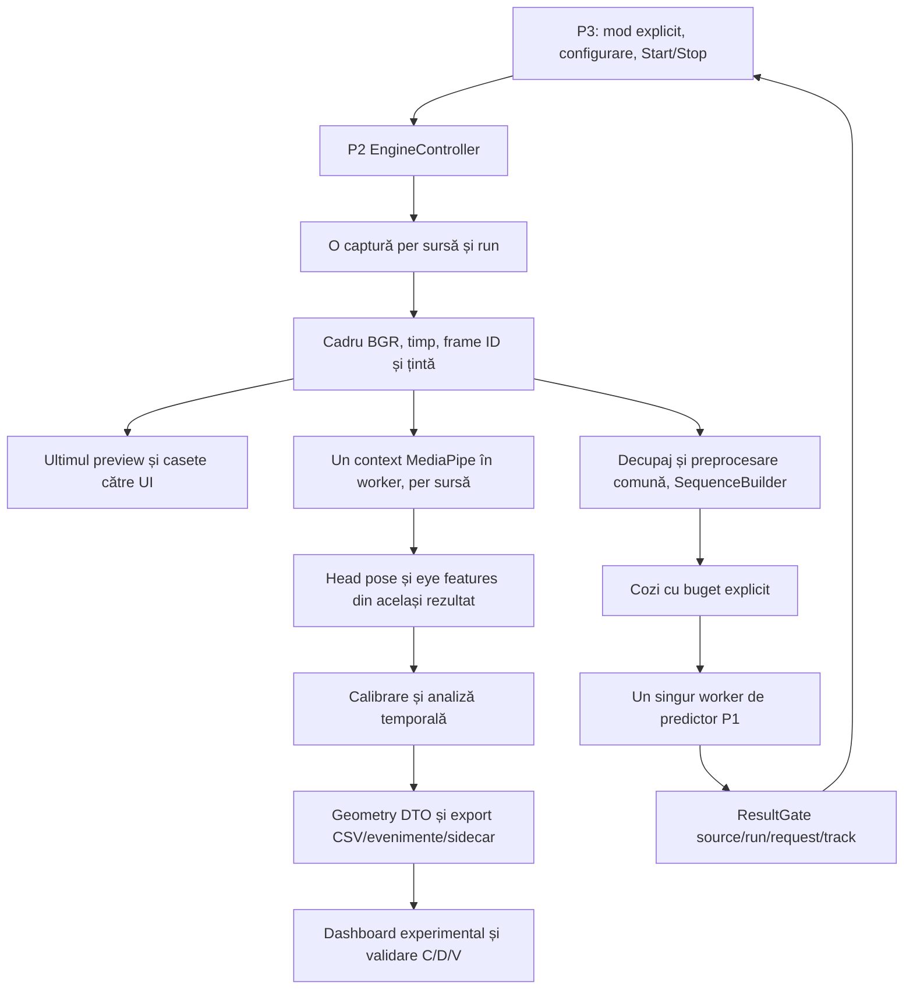

# Current Branch Analysis & Safe Merge Plan

Raport încheiat la **19 noiembrie 2026**, pe baza inspecției din 18–19 noiembrie. Repository: [artiomonilov/Analiza-Atentiei-Proiect-PI](https://github.com/artiomonilov/Analiza-Atentiei-Proiect-PI). **Analiză și planificare; comenzile de integrare din acest document nu au fost executate.**

Au fost citite auditul anterior de 530 de linii, bilanțul P1, codul și diferențele Git actuale. S-au folosit `git fetch --no-tags origin`, `ls-remote`, `show`, `diff`, `log`, `merge-base`, `ls-tree`, snapshoturi temporare `git archive`, pytest offscreen/offline și probe sintetice în memorie. Nu s-au făcut checkout/switch, merge, rebase, cherry-pick, commit, staging, push, instalări sau modificări funcționale. Singurul fișier nou destinat repository-ului este acest raport.

Niveluri de dovadă:

- **VERIFIED**: observat în Git/cod sau executat în această analiză, pentru SHA-ul indicat.
- **REPORTED**: consemnat de documentele anterioare, fără repetarea acelei verificări.
- **INFERRED**: concluzie sau soluție propusă din dovezile disponibile, nu implementare existentă.
- **UNKNOWN**: nu există dovezi suficiente; include hardware, date sau munca nepublicată pe calculatoarele colegilor.

## 1. Executive Summary

**Recomandare: NOT READY pentru integrarea finală în main; READY pentru pregătirea separată a corecțiilor și aprobarea contractelor.** Artiom are o bază software testată și publicată; blocajul principal nu mai este conservarea celor 25/63 de fișiere din auditurile anterioare.

Constatări **VERIFIED**:

1. Working tree-ul inițial este curat, HEAD local și `origin/artiom-branch` sunt `51597bc`. E6–E8, RealPredictor și corecțiile proprii există acum în Git și în remote. Nu mai sunt numai locale.
2. `origin/ema` a avansat la `3072d65`, iar `origin/ilie-p2` la `58d8a91`. Relația relevantă s-a schimbat: **Ilie este acum strămoș al Ema**. Ema include și Artiom până la `f4fcfc6`, însă nu include `51597bc`.
3. Între schimbările Artiom și Ema **de după merge-base f4fcfc6 nu există căi modificate în comun**. `git merge-tree --trivial-merge` nu a produs conflicte textuale. Aceasta nu certifică un produs compatibil.
4. Teste izolate: Artiom **292 passed, 3 deselected**; Ema actual **142 passed, 1 failed**; Ilie actual **32 passed, 1 failed**. În ambele ramuri, eșecul este testul adaptorului care încă așteaptă un stub.
5. Problemele P2 de contabilizare cross-run, lipsa limitei totale a cozii și expirarea trackingului se reproduc în continuare. S-a identificat și lipsa acoperirii unei ferestre de 10 s de către istoricul implicit de 128 de cadre la 30 FPS.
6. Ema a corectat filtrul care respingea rezultate reale și a adăugat selectarea video. Persistă însă bannerul de „AI reală” la `MODEL_UNAVAILABLE`, validări necontrolate și lipsa unui mod UI real conectat la P1.

**Strategia principală INFERRED:** branch temporar pornit din main exact, Artiom primul, apoi **Ema pregătită, care include P2 pregătit**. Nu se aduce încă o dată Ilie ca a treia integrare independentă. Se păstrează istoria și branchurile sursă.

Nu există pachet real de angajament identificat și evaluat, nici rezultate C/D/V pe persoane reverificate. O versiune comună poate livra geometrie și `MODEL_UNAVAILABLE`; nu poate pretinde atenție sau angajament real doar pentru că interfața pornește.

## 2. Branch Inventory

**VERIFIED:** cinci branchuri locale, patru referințe remote, șapte vârfuri distincte. `ls-remote --symref origin HEAD` confirmă `main` ca branch implicit. Fetch-ul final a reușit; vârfurile de mai jos au rămas neschimbate după actualizare. Nu s-au șters referințe prin prune.

| Branch/ref | SHA exact | Față de main | Stare local/remote și rol |
|---|---|---|---|
| `main`, `origin/main` — B | `4379f098fd0c5e728436dacd22fa835e22b37c0a` | 0/0 | Egale; bază comună legacy/template/planuri |
| `artiom-branch`, `origin/artiom-branch` — A | `51597bc5d45eb52085eeb25e6f8f9c0af442e426` | 8 înainte, 0 în urmă | Egale; P1 și laborator geometric/experimental |
| `ema` local — E0 | `86e5a90138b311580e5df76c1f7d7c0de181fa72` | 1 înainte | Cu 14 commituri în urma `origin/ema`; nu este versiunea UI de integrat |
| `origin/ema` — E | `3072d653f2557339d41b895a24a679554fcb8c25` | 15 înainte | Agregă P2 și geometria Artiom veche, plus UI nou |
| `origin/ilie-p2` — I | `58d8a91a518c06e2585847b3cf2828fde53def5b` | 6 înainte | Inclus integral în E; nu există branch local `ilie-p2` |
| `ema-branch` — H1 | `8142576297d7408d8938ce2677cbdc4d43d7320e` | 2 înainte | Numai local; experiment HF și arhivă mare |
| `backup-artiom-before-cleanup` — H2 | `4c29422045ebc5eabbe3b87bbb29ccb6ddde0e43` | 4 înainte | Numai local; istoric de conservat, fără funcții noi recomandate |

În tabelele următoare, `A:cale`, `E:cale`, `I:cale` înseamnă fișierul **din commitul exact de mai sus**, nu conținutul arbitrar al unui branch care poate avansa ulterior. Numele rolurilor sunt cele cerute în task; atribuirea completă a muncii istorice nu se deduce numai din numele branchului.

### Relații de istoric importante

- **VERIFIED:** merge-base A/E = `f4fcfc6b44a9011102964468d8840f7e241cd4d7`.
- **VERIFIED:** merge-base A/I = `b53e2fd03d97c4e272539690df5abe8168bf0884`, nu main.
- **VERIFIED:** I este strămoș al E; merge-base I/E este chiar I.
- **VERIFIED:** E0 este strămoș al I și E. H1 este strămoș al H2. H1/H2 nu sunt strămoși ai ramurilor active A/E/I.
- Toate vârfurile sunt descendente din B. Nu există istorii fără strămoș comun în această selecție.
- A are un singur commit lipsă din E: `51597bc`. E are opt commituri lipsă din A. I/E au 0/9 commituri exclusive; E0/E au 0/14.

Commituri relevante reverificate:

| Commit | Conținut efectiv / părinți |
|---|---|
| `51597bc` — 17 nov., Artiom Onilov | „predictor real”; 63 căi față de f4fcfc6, +5140/−167; include și E6–E8, corecțiile, testele și documentația |
| `4b9ee626000969b06a8388641c2440cf4b3b4b58` | Merge deja realizat de Ilie: părinți `dfea4b2` și `b53e2fd` |
| `58d8a91` — 16 nov., ilie | Cameră/rețea, reconectare, statistici; modifică motor/video și documentele lor |
| `3dacb92491a7d90b16542a2227935cea1689d633` | Merge deja realizat de Ema: E0 + Artiom f4fcfc6 |
| `e121ef5b8e3659d9b8222bd54bcd3873b5983d73` | Merge deja realizat de Ema: `3dacb92` + I |
| `1141705e786e7e0eb52605e93f78229b4dd45391` | Modifică numai `ui/main_window.py`; integrare UI și prezentare |
| `3072d65` — 18 nov., Ema Bruma | Modifică numai `ui/main_window.py`; vârful UI actual |

Autorii sunt metadate Git, nu certificarea autorului fiecărei linii. Ramura istorică `ema-branch` are commituri atribuite Git lui Artiom, nu trebuie tratată automat ca livrare P3.

## 3. Changes Since Previous Audit

| Aspect | Audit 16 nov. | Stare actuală verificată |
|---|---|---|
| Artiom publicat | f4fcfc6, 143 teste; E6–E8 necomise | A, sincron cu origin; E6–E8 și P1 funcționale în commit; 292 teste sigure trecute |
| Lucru local | 6 tracked + 19 untracked; ulterior bilanț de 63 fișiere | Zero modified/untracked la începutul analizei; cele 63 sunt în 51597bc |
| RealPredictor | Stub | Adaptor local load-once, manifest/checksum, CPU, intrare PreparedSequence, lipsă model explicită |
| Proveniență | R08/R09 deschise | Guard comun rows/events în `validation.evaluate`; materiale C/model/sidecaruri și teste prezente |
| CLI | Istoric video acumulat; HF nefixat | Streaming, întrerupere, revizie HF/cache local implicit, erori redacționate |
| Mediu | torchvision absent, două OpenCV în .venv | .venv vechi păstrat; .venv-completion separat, torchvision disponibil și un singur OpenCV |
| Ilie | dfea4b2; fișiere, fără live | I; cameră/network și reconectare implementate în cod, hardware necercetat aici |
| Ema | E0; selector imagini, respinge rezultate reale | E; selector video/imagine și acceptarea rezultatului real corectate; probleme de mod/mesaje rămase |
| Ancestry | E0 inclus în Ilie | Vârful Ilie este inclus în Ema; Ema este agregatul actual P2/P3 |

Bilanțul anterior care spune „zero commituri create” descrie intervenția de atunci, nu starea Git de acum. Commitul A și publicarea sa sunt observate ulterior; nu au fost efectuate în această analiză. Checklisturile academice și lipsa datelor/ponderilor reale nu sunt închise de publicarea codului.

## 4. Branch Completion Status

| Ramură | Funcționalități și cod reutilizabil verificate | Teste / dependențe / ce lipsește |
|---|---|---|
| B main | Template P1/P2/P3 simulat; contracte/config; legacy dataset/mean/GRU/runtime/UI; planuri/notebookuri | 27 teste configurate trecute; NumPy/Qt, opționale pentru legacy. Nu conține laboratorul nou sau predictorul P1 complet |
| A Artiom | Face Landmarker IMAGE/VIDEO, pose SVD/neutru, EAR/iris, video/webcam sincron, temporal/clipiri, calibrare, validare, dashboard, C/D/V, manifest/cache P1, fabrici mean/GRU multi-head, RealPredictor, comparații R0 și CLI streaming | 292 passed, 3 deselected; MP/OpenCV, QtCharts, torch/torchvision/HF după funcție. Nu are pachet de angajament evaluat; nu este conectat la engine P2 actual |
| I Ilie | Fișier/imagine, YuNet și decupaje, tracking IoU anonim, SequenceBuilder per track, mailbox per track, un AI QThread, preview limitat; cameră/rețea cu ultim cadru, monotonic și retry; EngineStats | 32 passed, 1 failed; teste P2 noi pentru live/tracking/stats nu au fost adăugate. Nu conține E1–E8 complet sau P1 nou; lifecycle și capacitate neacceptabile încă |
| E Ema | Tot I; geometria Artiom până la f4fcfc6; formular, alegere video/imagine, afișare `is_demo=False`, mesaje de lipsă predicție și banner dinamic | 142 passed, 1 failed; fără teste noi pentru cele două commituri UI. Nu are E6–E8/P1 din A; un card, fără desenarea casetelor sau grilă finală/export UI |
| E0 ema local | Formularul istoric și lipsa predicției | 27 teste trecute; bugul original SourceConfig pentru cale există pe E0, nu reprezintă codul E actual |
| H1/H2 istorice | SPEC/README și experiment HF istoric; H2 elimină arhiva numai la vârf | Inspecție statică; nu se recomandă rularea importului vechi `test_net.py`. Nicio funcționalitate unică necesară integrării nu a fost identificată |

Față de B: A are **77 căi** (61 adăugate, 16 modificate), E **51** (31 adăugate, 20 modificate), I **30** (10 adăugate, 20 modificate), E0 una modificată, H1 patru (2 A/2 M), H2 patru (1 A/3 M). Inventarele reproductibile sunt în §7.

### Artiom — readiness pe componente

| Componentă A | În HEAD și origin? | Dovadă / limită |
|---|---|---|
| Face Landmarker, head pose, eye features | Da | Module și teste geometrice; inferența pe populația țintă nu este validată aici |
| Video/temporal | Da | `video_processor.py`, `temporal_analysis.py`; CLI independent, nu engine-ul multi-sursă |
| Calibration / Validation | Da | `calibration.py`, `validation.py`; R08 centralizat la liniile 306–308; teste de alterare rows/events |
| Dashboard / C/D/V | Da | `dashboard_data.py`, `experimental.py`, `ui/experimental_dashboard.py`, scripturi root și teste |
| AI Data / Model / RealPredictor | Da | `ai/data.py`, `models.py`, `package.py`, `predictor.py`; fără weights reale validate |
| CLI / rapoarte / API geometric | Da | streaming și `geometric_api.py`; DTO-ul geometric încă nu are integrarea track_id/epoch în engine |

**ARTIOM BRANCH — READY ca sursă software versionată pentru integrarea etapizată; NOT READY ca aplicație comună finală.** Contractele comune trebuie convenite, iar lipsa modelului se păstrează explicită. P1 real și geometria nu trebuie combinate cu un scheduler/captură paralelă.

## 5. Uncommitted Work and Preservation

**VERIFIED la început:** `git status --porcelain=v1 -uall`, `git diff` și indexul sunt goale; A = origin/A. Main este sincron. E0 este în urmă, fără commituri locale unice față de E. H1/H2 au istoric local nepublicat, de conservat, nu de integrat implicit. Munca necomisă de pe calculatoarele Ema/Ilie este **UNKNOWN**.

Nu trebuie refăcut automat commitul celor 63 de fișiere: acestea sunt deja în A. Snapshoturile vechi din `artifacts/branch-preservation/` sunt **REPORTED** ca mecanism suplimentar de conservare, nu substitut pentru Git actual. Sunt ignorate de Git, alături de venv, rezultate și modelul `.task`.

Fișierul local `models/face_landmarker.task` există, dar Git urmărește numai README din models; `.task`, `.pt`, cache-uri și videoclipuri nu se adaugă în commituri. Un clone nu primește automat modelele sau datele locale. Pentru conservare viitoare sunt suficiente SHA-urile fixate, working tree curat, branchuri sursă păstrate și copii autorizate separate pentru modelele/datele necesare.

Nu se folosesc `stash -u`, reset, clean sau checkout peste modificări noi. Dacă apar între timp, planul se oprește până la review și conservare explicită. Raportul nou se publică doar într-o etapă aprobată ulterior; aici rămâne untracked.

## 6. Compatibility Matrix

Toate stările de compatibilitate se referă la interfețe actuale, nu la o aplicație deja integrată.

| Legătură | Ce este compatibil VERIFIED | Gap / lucru necesar INFERRED |
|---|---|---|
| P1 A → P2 I/E | `predict(PreparedSequence) -> ModelOutput`; aceleași forme float32 RGB `[T,3,H,W]`, timestampuri în secunde, normalizare în prepare_bgr. Proba P08 confirmă paritate pe pixeli sintetici | Configurația reală trebuie preluată din manifest, nu din demo; istoric suficient pentru fereastra modelului; injectare factory RealPredictor și stare fără model, fără Fake implicit |
| P2 → P3 E | Semnale Qt și injectare motor; IDs source/run/request; E acceptă acum is_demo=False; track_id există în mesajele P2 | UI nu selectează mod real funcțional, nu afișează track/casete, nu controlează toate erorile; un singur card. Închiderea live trebuie garantată |
| Geometrie A → P2 | FaceLandmarker poate primi cadre BGR; head/eye reutilizează același rezultat; payloaduri serializabile există | O captură/sursă, o inferență MP/cadru selectat, context calibrat per țintă; legare frame/run/track/epoch și reset la discontinuitate |
| P2 → dashboard A | Istoricul AI are CSV, iar dashboardul citește CSV geometric cu timestamp_ms și availability | Sunt **două scheme diferite**. Nu este validă importarea CSV-ului PredictionResult ca măsurători geometrice. Export dedicat per cadru + sidecar/evenimente, apoi importerii existenți |
| Engine → C/D/V A | A are FrozenExperiment și guard final rows/events, model/code/env/rol | Workerul P2 nu emite aceste receipts. Trebuie adaptor de export cu digesturi efective și validarea planului înainte de V |
| Legacy → P1 nou | Arhitectura MobileNet mean/GRU reutilizată | Legacy RGB uint8 NHWC și normalizare internă diferă de PreparedSequence; bundle legacy nu devine valid prin redenumire. Conversia cere metadata/config și evaluare reală |

### Contract alignment propus înainte de conectare

| Contract | Stare actuală VERIFIED | Regulă propusă / acceptare |
|---|---|---|
| SourceConfig | I:contracts.py:51; kind/location, plus shim pozițional pentru UI | Constructori cu keywords: source_id anonim, display_name, kind explicit, location. Validează în try-ul UI, nu ghici orice typo ca fișier. Camera/network tratate distinct |
| FramePacket | I:contracts.py:72; BGR uint8 imuabil, source/run/frame, media_time_s, casete și track_ids aliniate | Preview și măsurare cu aceeași cheie; păstrează originea timpului și indexul decoderului; nu confunda frame_id livrat live cu indexul unei înregistrări |
| PreparedSequence / config | Contract identic; prepare_bgr numeric compatibil | T/H/W/scale/mean/std/window/toleranță din model, fără dublă normalizare; crop/margine/min face documentate și aceleași la train/inference |
| InferenceRequest / Result | request_id și track_id în rulare | Cheie de contabilizare `(source_id,run_id,request_id)`; selecție/ordine per track unde e aprobat; completarea veche nu atinge run nou |
| ModelOutput | levels 0–3 numai pe dimensiunile modelului, versiune, is_demo | Geometria rămâne separată. MODEL_UNAVAILABLE => levels=None, niciodată zero sau Fake mascat |
| Timp | P2 file=index/FPS, live=monotonic; A FrameClock suportă POS_MSEC/fallback | Fișier: reutilizează regula FrameClock și păstrează originea; live: monotonic relativ la run, continuu peste reconnect, cu epoch de discontinuitate. Conversie s→ms într-un singur adaptor |
| Geometry DTO | A:geometric_api.py:9,27; schema_version=1, source/run/session, measurement, availability/unități/calibrare/model | Nu conține azi track_id/epoch. Extindere compatibilă sau wrapper versionat cu frame_id și ținta selectată; nu se pretinde că există deja. Grade yaw/pitch/roll, EAR adimensional, iris normalizat local |
| Evenimente | SourceStatusEvent are event_id; BlinkEvent are eye/start/end/duration/status, fără event_id global | Cheie de deduplicare documentată în wrapper: run/epoch/track/eye/start/end; timebase comun. Manualele rămân în flux separat |
| Session metadata | A: ID anonim, rol C/D/V, config, dată, durată, SHA cod/model/surse | Sidecarul și digesturile trebuie să provină din exportul efectiv; nu se inventează receipt peste date arbitrare |
| Availability / erori | Flaguri geometrice și None/N/A; status AI separat | Lipsă față, model lipsă și „zero evenimente observate” sunt stări distincte; bannerul se bazează și pe status, nu doar pe is_demo |

Nu există un DTO distinct numit EngineStatus în schema inspectată: motorul emite SourceStatusEvent și PredictionResult. Extinderea stărilor se face explicit cu teste/docs, nu prin presupunerea unei clase inexistente.

## 7. Git Conflict Matrix

**Metodă VERIFIED:** merge-base unic, listele `git diff --name-only <base> <tip>`, comparații de blob și `git merge-tree --trivial-merge <base> <ours> <theirs>`. Ultima comandă este forma read-only cu trei arbori; nu s-au folosit `merge-tree --write-tree`, index temporar sau merge real. Lipsa conflictelor observate este limitată la SHA-urile prezente. După corecțiile pre-merge se repetă verificarea.

| Pereche / direcție relevantă | Merge-base | Commituri exclusive stânga/dreapta | Suprapuneri după bază / risc textual |
|---|---|---|---|
| B → A | B | 0/8 | Descendență; fără divergență textuală |
| B → I | B | 0/6 | Descendență; nu certifică funcțiile P2 |
| B → E | B | 0/15 | Descendență; nu se recomandă direct în main |
| A ↔ E | f4fcfc6 | 1/8 | **0 căi comune** după bază; merge-tree fără markeri de conflict |
| A ↔ I | b53e2fd | 6/4 | **0 căi comune** după bază; merge-tree fără markeri de conflict |
| I → E | I | 0/9 | Ilie este deja inclus; nu există merge P2 suplimentar necesar pentru aceste vârfuri |
| E0 → I / E | E0 | 0/5, respectiv 0/14 | Cod E0 deja inclus; local ema este învechit |
| A ↔ E0 | B | 8/1 | A nu schimbă UI operațional față de B; fără overlap, însă E0 este depășit |
| H1 → H2 | H1 | 0/2 | Istoric inclus în backup; nu necesită integrare în produs |
| H1/H2 ↔ A/E/I | B | Divergente | SPEC/README/test_net/.gitignore au suprapuneri istorice; excludere justificată, nu promisiune de merge curat |

**38 de căi sunt comune în diffurile A și E față de main**, în mare parte geometria/CLI deja moștenite din f4fcfc6. Acestea NU sunt 38 de conflicte: raportarea corectă folosește merge-base A/E=f4fcfc6. Față de acea bază, A schimbă 63 de căi, iar E schimbă alte 13, disjuncte.

Cele 13 căi P2/P3 aduse de E peste f4fcfc6 sunt:

```text
M src/audience_analysis/contracts.py
M src/audience_analysis/engine/README.md
M src/audience_analysis/engine/controller.py
M src/audience_analysis/engine/scheduler.py
A src/audience_analysis/engine/stats.py
M src/audience_analysis/engine/workers.py
M src/audience_analysis/ui/history.py
M src/audience_analysis/ui/main_window.py
M src/audience_analysis/video/README.md
M src/audience_analysis/video/preprocessing.py
M src/audience_analysis/video/sequences.py
M src/audience_analysis/video/sources.py
A src/audience_analysis/video/tracking.py
```

Listele complete și distincția A/M pentru fiecare branch se reproduc fără checkout:

```powershell
git diff --name-status 4379f098fd0c5e728436dacd22fa835e22b37c0a 51597bc5d45eb52085eeb25e6f8f9c0af442e426
git diff --name-status 4379f098fd0c5e728436dacd22fa835e22b37c0a 3072d653f2557339d41b895a24a679554fcb8c25
git diff --name-status 4379f098fd0c5e728436dacd22fa835e22b37c0a 58d8a91a518c06e2585847b3cf2828fde53def5b
git diff --name-status main ema
git diff --name-status main ema-branch
git diff --name-status main backup-artiom-before-cleanup
```

### Inventare complete de fișiere față de main

Aceste liste sunt VERIFIED prin `git diff --name-status B <SHA>`. `A` înseamnă fișier adăugat, `M` modificat; nu sunt liste de conflicte. Codul comun moștenit apare firesc în mai multe liste.

<details>
<summary>artiom-branch — 77 căi</summary>

```text
M	.gitignore
M	AGENTS.md
M	Proiect_Analiza_atentiei_si_angajamentului_AI.md
M	README.md
A	calibrate_session.py
A	compare_blinks.py
A	configs/constraints-windows-py313.txt
A	configs/experiment_V01.example.json
A	configs/temporal.example.json
A	configs/validation.example.json
M	docs/STATUS.md
A	docs/artiom-branch-completion.md
A	docs/calibration-validation.md
M	docs/contracts.md
A	docs/dashboard-validation.md
A	docs/environment.md
A	docs/eye-features.md
A	docs/face-landmarker-verification.md
A	docs/head-pose.md
A	docs/p1-data-model.md
A	docs/p1-research-and-presentation.md
A	docs/project-audit-week-2026-11-16.md
A	docs/real-world-evaluation.md
A	docs/temporal-analysis.md
A	docs/video-processing.md
A	experimental_session.py
A	models/README.md
M	pyproject.toml
A	run_dashboard.py
A	run_validation.py
A	run_video_analysis.py
M	src/audience_analysis/__main__.py
M	src/audience_analysis/ai/README.md
A	src/audience_analysis/ai/cli.py
M	src/audience_analysis/ai/data.py
A	src/audience_analysis/ai/evaluation.py
M	src/audience_analysis/ai/models.py
A	src/audience_analysis/ai/package.py
M	src/audience_analysis/ai/predictor.py
A	src/audience_analysis/calibration.py
A	src/audience_analysis/dashboard_data.py
A	src/audience_analysis/engagement.py
A	src/audience_analysis/experimental.py
A	src/audience_analysis/eye_features.py
A	src/audience_analysis/face_landmarker.py
A	src/audience_analysis/geometric_api.py
A	src/audience_analysis/head_pose.py
M	src/audience_analysis/metrics.py
A	src/audience_analysis/model_stats.py
A	src/audience_analysis/pipeline.py
A	src/audience_analysis/temporal_analysis.py
A	src/audience_analysis/terminal.py
A	src/audience_analysis/ui/experimental_dashboard.py
A	src/audience_analysis/validation.py
A	src/audience_analysis/video_processor.py
A	src/audience_analysis/vision.py
A	start-analysis.ps1
A	test_face_landmarker.py
A	tests/ai/test_p1_completion.py
M	tests/ai/test_predictors.py
A	tests/terminal/test_calibration.py
A	tests/terminal/test_dashboard.py
A	tests/terminal/test_experimental.py
A	tests/terminal/test_eye_features.py
A	tests/terminal/test_face_landmarker.py
A	tests/terminal/test_geometric_api.py
A	tests/terminal/test_head_pose.py
A	tests/terminal/test_pipeline.py
A	tests/terminal/test_pipeline_streaming.py
A	tests/terminal/test_temporal_analysis.py
A	tests/terminal/test_terminal.py
A	tests/terminal/test_validation.py
A	tests/terminal/test_video_processor.py
M	tests/test_experiment.py
M	tests/test_models.py
A	tests/test_net.py
A	validation_dataset/README.md
```

</details>

<details>
<summary>origin/ema — 51 căi</summary>

```text
M	.gitignore
M	AGENTS.md
M	Proiect_Analiza_atentiei_si_angajamentului_AI.md
M	README.md
A	compare_blinks.py
A	configs/temporal.example.json
M	docs/STATUS.md
M	docs/contracts.md
A	docs/eye-features.md
A	docs/face-landmarker-verification.md
A	docs/head-pose.md
A	docs/temporal-analysis.md
A	docs/video-processing.md
A	models/README.md
M	pyproject.toml
A	run_video_analysis.py
M	src/audience_analysis/__main__.py
M	src/audience_analysis/contracts.py
A	src/audience_analysis/engagement.py
M	src/audience_analysis/engine/README.md
M	src/audience_analysis/engine/controller.py
M	src/audience_analysis/engine/scheduler.py
A	src/audience_analysis/engine/stats.py
M	src/audience_analysis/engine/workers.py
A	src/audience_analysis/eye_features.py
A	src/audience_analysis/face_landmarker.py
A	src/audience_analysis/head_pose.py
A	src/audience_analysis/model_stats.py
A	src/audience_analysis/pipeline.py
A	src/audience_analysis/temporal_analysis.py
A	src/audience_analysis/terminal.py
M	src/audience_analysis/ui/history.py
M	src/audience_analysis/ui/main_window.py
M	src/audience_analysis/video/README.md
M	src/audience_analysis/video/preprocessing.py
M	src/audience_analysis/video/sequences.py
M	src/audience_analysis/video/sources.py
A	src/audience_analysis/video/tracking.py
A	src/audience_analysis/video_processor.py
A	src/audience_analysis/vision.py
A	start-analysis.ps1
A	test_face_landmarker.py
M	tests/ai/test_predictors.py
A	tests/terminal/test_eye_features.py
A	tests/terminal/test_face_landmarker.py
A	tests/terminal/test_head_pose.py
A	tests/terminal/test_pipeline.py
A	tests/terminal/test_temporal_analysis.py
A	tests/terminal/test_terminal.py
A	tests/terminal/test_video_processor.py
A	tests/test_net.py
```

</details>

<details>
<summary>origin/ilie-p2 — 30 căi</summary>

```text
M	.gitignore
M	AGENTS.md
M	Proiect_Analiza_atentiei_si_angajamentului_AI.md
M	README.md
M	docs/STATUS.md
M	docs/contracts.md
M	pyproject.toml
M	src/audience_analysis/__main__.py
M	src/audience_analysis/contracts.py
A	src/audience_analysis/engagement.py
M	src/audience_analysis/engine/README.md
M	src/audience_analysis/engine/controller.py
M	src/audience_analysis/engine/scheduler.py
A	src/audience_analysis/engine/stats.py
M	src/audience_analysis/engine/workers.py
A	src/audience_analysis/model_stats.py
A	src/audience_analysis/pipeline.py
A	src/audience_analysis/terminal.py
M	src/audience_analysis/ui/history.py
M	src/audience_analysis/ui/main_window.py
M	src/audience_analysis/video/README.md
M	src/audience_analysis/video/preprocessing.py
M	src/audience_analysis/video/sequences.py
M	src/audience_analysis/video/sources.py
A	src/audience_analysis/video/tracking.py
A	src/audience_analysis/vision.py
M	tests/ai/test_predictors.py
A	tests/terminal/test_pipeline.py
A	tests/terminal/test_terminal.py
A	tests/test_net.py
```

</details>

<details>
<summary>ema — 1 căi</summary>

```text
M	src/audience_analysis/ui/main_window.py
```

</details>

<details>
<summary>ema-branch — 4 căi</summary>

```text
M	Proiect_Analiza_atentiei_si_angajamentului_AI.md
M	README.md
A	archive.zip
A	tests/test_net.py
```

</details>

<details>
<summary>backup-artiom-before-cleanup — 4 căi</summary>

```text
M	.gitignore
M	Proiect_Analiza_atentiei_si_angajamentului_AI.md
M	README.md
A	tests/test_net.py
```

</details>

<details>
<summary>Cele 38 de căi comune A/E față de main, deja partajate prin f4fcfc6</summary>

```text
.gitignore
AGENTS.md
Proiect_Analiza_atentiei_si_angajamentului_AI.md
README.md
compare_blinks.py
configs/temporal.example.json
docs/STATUS.md
docs/contracts.md
docs/eye-features.md
docs/face-landmarker-verification.md
docs/head-pose.md
docs/temporal-analysis.md
docs/video-processing.md
models/README.md
pyproject.toml
run_video_analysis.py
src/audience_analysis/__main__.py
src/audience_analysis/engagement.py
src/audience_analysis/eye_features.py
src/audience_analysis/face_landmarker.py
src/audience_analysis/head_pose.py
src/audience_analysis/model_stats.py
src/audience_analysis/pipeline.py
src/audience_analysis/temporal_analysis.py
src/audience_analysis/terminal.py
src/audience_analysis/video_processor.py
src/audience_analysis/vision.py
start-analysis.ps1
test_face_landmarker.py
tests/ai/test_predictors.py
tests/terminal/test_eye_features.py
tests/terminal/test_face_landmarker.py
tests/terminal/test_head_pose.py
tests/terminal/test_pipeline.py
tests/terminal/test_temporal_analysis.py
tests/terminal/test_terminal.py
tests/terminal/test_video_processor.py
tests/test_net.py
```

</details>

### Required Merge Matrix

| Source Branch | Target | Changes | Dependencies | Conflicts | Required Fixes | Tests | Merge Order | Risk |
|---|---|---|---|---|---|---|---|---|
| A Artiom | codex/integration-2026-11-19 | P1, E1–E8, CLI, rapoarte și pachet | Mediu/model local; contracte aprobate | Textual: niciun overlap actual cu E; semantic: engine/geometrie încă nelegate | P1 config/pachet și schema de predare; indisponibilitate explicită | 292 sigure + noi teste contractuale | 1 | Mediu; fără rezultate DAiSEE |
| I Ilie, apoi corecții P2 | Ramura de pregătire P3 pornită din E | P2 există deja în E; se adaugă numai corecțiile viitoare | Gate contract/lifecycle | Runtime/cozi/tracking/timpi; nu se reimportă vechiul P2 ca feature separat | F01/F02/F03/F04/F05/F06 | Regresii P2 și live mock | Pregătire înainte de 2 | Ridicat înainte de remedieri |
| E Ema, actualizată cu P2 pregătit | codex/integration-2026-11-19 | Agregat P2/P3, selector și afișare | P2 corectat și P3 verificate; SHA nou fixat | Semantic demo/real, formulare, preview; eventuale conflicte noi se recalculează | F07/F08 și acceptarea configurației comune | UI + P2 + apoi întreaga suită A | 2 | Ridicat până la gate-uri |
| E0 ema local | Nicio integrare separată | Versiune istorică a formularului | Strămoș al E/I | Depășit, constructor vechi | Se folosește E; actualizarea locală este opțională și ulterioară | 27 baseline, nu acceptare E | Exclus | Risc de revenire la UI veche |
| H1 ema-branch | Nicio integrare | Experiment HF, SPEC/README, archive.zip | Nicio cerință nouă demonstrată | Arhivă de 171396591 bytes; `inputs` nedefinit și downloaduri la import | Păstrare istoric; fără execuție/import implicit | Static, fără rezultate pytest pretinse | Exclus | Ridicat dacă e adus integral |
| H2 backup | Nicio integrare | Istoric de backup și eliminare arhivă la tip | H1 este deja strămoș | Blobul mare rămâne în istorie; codul util este deja copiat în linia activă | Conservare, fără ștergere/rescriere | Static; backup nu a fost rulat | Exclus | Ridicat la propagarea istoriei |
| Branch integrare acceptat | main | O versiune comună revizuită | Toate gate-urile; main nemodificat sau reanalizat | Semantica este criteriul, nu numai textul | Review și mod de produs declarat | Instalare, regresie, E2E, rollback | Ultimul | Acceptabil numai condiționat |

## 8. Semantic Conflict Analysis

Probe P01–P09: codul exact E/I a fost încărcat în module Python temporare în memorie cu importuri separate; P08 folosește și codul P1 din A. Nu s-a scris un arbore integrat și nu s-a creat un commit. Datele sunt sintetice; P05 folosește un rezultat de fixture, nu un model antrenat.

| ID | Dovadă actuală / tip de conflict | Stare și consecință |
|---|---|---|
| F01 / vechi R03 | I:controller.py:111 complete înainte de gate; scheduler.py:78 nu primește run_id. **P01:** old run request 0 în calcul, new run request 0 în coadă, completare old => pending S=1, has_outstanding=False | **VERIFIED activ**, runtime/lifecycle. Poate declanșa EOF/drain prematur pe run nou. Gate-ul UI nu repară contabilizarea deja alterată |
| F02 / R04 | I:scheduler.py:57 mailbox per track fără limită totală. **P02:** 100 trackuri distincte => pending S=100 | **VERIFIED activ**, arhitectură/backpressure; nu se pretinde măsurare RAM. Limita per track nu este limită per sursă/globală |
| F03 / R05 | I:tracking.py:45 face matching înainte de expirare la :65. **P03:** aceeași casetă t=0 și t=1, absență la .1, max_missed=.5 => ID 0 reutilizat | **VERIFIED activ**; se poate amesteca continuitatea geometriei/calibrării. La track ended/reconnect mai trebuie curățate cererile vechi, nu numai builders |
| F04 nou | I:sources.py:181–186. **P04**, capture mock blocat: close depășește join, apoi read este deblocat; firul moare, release_calls rămâne 0 | **VERIFIED** lipsa eliberării explicite pe această cale. Nu dovedește leak permanent pe hardware sau absența cleanup prin GC. Este necesar owner/finally al capturii, fără release concurent peste read |
| F05 / R06 | I:sources.py:60 folosește index/FPS pentru fișiere; live folosește deja monotonic și origin păstrat la reconnect | **VERIFIED** diferență de convenții; eroarea reală pe VFR este **UNKNOWN**. Camera/network există acum; stop/open/read backend nu au garanție universală, iar fallbackul network deschide fără parametrii FFmpeg de timeout |
| F06 nou | I:video/sequences.py, max_frames=128. **P09:** 600 cadre la 30 FPS, fereastră 10 s/T=16 => 0 secvențe la 128; același test cu 320 => 10 secvențe | **VERIFIED activ** pentru configurația probei. Pregătirea P1 poate fi numeric corectă, însă engine-ul nu livrează ferestrele modelului. Necesită istoric/sampling temporal dimensionat și tot limitat |
| F07 / R02 actualizat | E:ui/main_window.py:158 acceptă acum is_demo=False. **P05:** fixture real acceptat în istoric. **P06:** MODEL_UNAVAILABLE/levels=None primește tot bannerul „ANALIZA AI REALA — predictie din model” la :169 | Vechiul filtru este **VERIFIED corectat**, bannerul este **VERIFIED greșit**. În plus E:__main__.py:103–107 creează doar FakePredictor/demo=True, iar formularul poate deschide surse reale |
| F08 / R01 actualizat | Shimul I:SourceConfig acceptă acum calea pozițională folosită de E; constructorul este tot înainte de try la E:124. **P07:** display_name gol => ValueError necontrolat. Catch-ul pentru add_source ignoră toate ValueError | Calea normală veche nu mai trebuie raportată ca defectul E0; validarea formularului este încă **VERIFIED incompletă**. Cu DemoEngine, o sursă reală refuzată poate lăsa vechiul demo să pornească |
| F09 / R07 | E:refresh_preview:185 convertește cadrul, nu desenează face_boxes/track_ids; un source/current_run/card. P2 produce toate fețele, MP maximum una | **VERIFIED** lipsă UI/contract de țintă. Asocierea geometriei cu aceeași persoană este **NECONFIRMATĂ**; nu folosi implicit primul/cel mai mare rezultat din două detectoare diferite |
| F10 / R08–R09 | A:validation.py:306–308 și experimental.py:198; testele din A verifică rows/events/rol/code/model și separarea materialelor C cunoscute | **VERIFIED software corectat**, nu bug activ vechi. P2 nu emite încă proveniența necesară; hashurile nu dovedesc independența semantică a unor re-encodări sau consimțământul |
| F11 / R13 | **P08:** SequenceBuilder E și prepare_sequence A dau exact aceleași valori/shape `[4,3,24,32]` pe fixture; ModelOutput/PreparedSequence sunt compatibile structural | **VERIFIED numai pe fixture/config de probă.** Nu demonstrează paritate Colab/laptop/model real sau echivalența cropului YuNet cu datele de training |
| F12 / R11,R15,R17 | A folosește opencv-contrib și entry points/root modules; E/I pyproject încă cer opencv-python și au doar două entry points. A corectează HF/offline/privacy și streaming | Conflict de dependențe/comportament **VERIFIED ca diferență**, fără conflict textual actual deoarece A are singura schimbare după bază. Păstrează corecțiile A; validează wheel-ul care include P2 nou |
| F13 / R05 teste | Același test `test_real_adapters_are_explicit` așteaptă NotImplementedError, dar implementarea ridică FileNotFoundError pentru not-opened.mp4 | **VERIFIED** prin două rulări pytest; actualizare justificată a așteptării + teste noi pe funcțiile implementate, nu eliminarea testului |
| F14 memorie/stats | E:history.py:10,18 și lista UI păstrează toate rezultatele; EngineStats limitează p95 la 2000 valori, dar rejected vechi incrementează statisticile sursei curente fără verificarea run_id | **VERIFIED prin cod**, impact hardware **UNKNOWN**. Policy de retenție/export și statistici izolate pe run sunt necesare înainte de promisiuni de sesiuni lungi |

Surse principale: [scheduler I](https://github.com/artiomonilov/Analiza-Atentiei-Proiect-PI/blob/58d8a91a518c06e2585847b3cf2828fde53def5b/src/audience_analysis/engine/scheduler.py), [controller I](https://github.com/artiomonilov/Analiza-Atentiei-Proiect-PI/blob/58d8a91a518c06e2585847b3cf2828fde53def5b/src/audience_analysis/engine/controller.py), [sources I](https://github.com/artiomonilov/Analiza-Atentiei-Proiect-PI/blob/58d8a91a518c06e2585847b3cf2828fde53def5b/src/audience_analysis/video/sources.py), [UI E](https://github.com/artiomonilov/Analiza-Atentiei-Proiect-PI/blob/3072d653f2557339d41b895a24a679554fcb8c25/src/audience_analysis/ui/main_window.py), [predictor A](https://github.com/artiomonilov/Analiza-Atentiei-Proiect-PI/blob/51597bc5d45eb52085eeb25e6f8f9c0af442e426/src/audience_analysis/ai/predictor.py).

## 9. Pre-Merge Fixes

Ordinea gate-urilor propuse: **contracte → P2 → P3 → pachet/config P1 → testare pe branchurile pregătite → integrare**. Nu toate cele 27 de taskuri academice ale fiecărui rol sunt condiții pentru primul build geometric; datele/modelul real rămân condiții pentru a-l numi MVP de angajament.

Înainte de a aduce agregatul E în integrare sunt obligatorii: F01/F02/F03/F04/F06, testul F13, politica temporală F05, modul real/demo și erorile F07/F08, politica de față F09, contractele și configurația P1. F10 trebuie păstrat, nu reimplementat divergent.

Pentru o primă versiune verificabilă se recomandă **o țintă facială selectată explicit per sursă**, fără identitate biometrică. Schimbarea țintei ori discontinuitatea invalidează ferestrele, cererile și calibrarea care nu mai corespunde. Alegerea multi-track este posibilă numai cu buget global/per sursă, expirare/cleanup, calibrare per țintă și UI corespunzător. Este o decizie comună, nu o extindere implicită.

Pot urma după prima integrare tehnică, dar înaintea declarării funcțiilor respective: grila 3–4 surse P3, tuning de performanță măsurat, raportul de 10 minute, testele pe cameră/rețea autorizată și studiile reale de model. Retenția bounded și stop sigur nu se amână dacă buildul este prezentat drept live sau pentru sesiuni lungi.

## 10. Recommended Merge Order and Strategy

| Strategie | Evaluare INFERRED |
|---|---|
| Merge direct în main | Respins acum: mută imediat baseline-ul stabil și importă funcțiile fără gate-uri |
| Artiom → Ilie → Ema | Nu ca lanț între branchurile personale: modifică livrările colegilor și repetă relațiile deja existente |
| Ilie → Artiom → main | Nu izolează riscul și nu aduce separat ultimele schimbări UI E |
| Branch temporar din main | **Alegerea principală:** bază exactă, Artiom separat verificabil, apoi agregat P2/P3 pregătit, review/rollback înainte de main |
| Cherry-pick selectiv | Nerecomandat principal: contractele/worker/scheduler/tracking din P2 sunt coordonate; istoria deja are merge-uri utile. Numai pentru un fix autonom viitor aprobat |
| Etapizare cu adaptoare stabile | Mod de lucru în branchul temporar ales, nu o a doua strategie concurentă sau o rescriere |

Bază exactă: B. Branch propus, necreat: **`codex/integration-2026-11-19`**. Prima integrare: A. A doua: un **SHA E_READY nou**, revizuit și descendent din E și din P2_READY. Acesta nu poate fi numit exact înainte ca remedierile să existe; se consemnează înainte de execuție. A integra azi E nemodificat nu îndeplinește gate-urile.

P2 lucrează pe o ramură pornită din I. P3 lucrează pe o ramură pornită din E și aduce corecțiile P2 înainte de predare. Astfel se păstrează munca fiecăruia, iar integrarea finală nu are o etapă separată de adăugare a vechiului I. Dacă echipa schimbă această relație, se reface inventarul și planul; nu se presupune că o ramură cu același nume păstrează același conținut.

## 11. Integration Architecture

**INFERRED / propunere, nu traseu executat:** un pachet Python, servicii locale și Qt; fără server web sau captură suplimentară în UI.



- P2 deține capturile, cadrajele, backpressure-ul și firul predictorului. UI nu apelează modelul și nu deschide VideoCapture.
- În prima legare, etapa geometrică este serială în workerul sursei, cu o instanță MP deținută exclusiv; dacă măsurătorile cer alt worker, i se definește un buget și o politică explicită de omiterea cadrelor. Nu se pornește VideoProcessor peste aceeași sursă deja deschisă.
- Head pose și ochii consumă rezultatul aceleiași inferențe. Coordonatele unui crop se remapează explicit la cadrul întreg pentru overlay; nu se aplică o matrice/calibrare calculată pe altă țintă.
- Profilul se alege înaintea runului. Schimbarea config/calibrării/țintei deschide un nou run/epoch și golește datele incompatibile. Fără profil suficient, availability rămâne falsă/None.
- Predictorul este creat o dată în workerul AI. În modul real se injectează RealPredictor dacă există pachet verificat; altfel indisponibilitate explicită. În demo, FakePredictor și banner SIMULARE; citirea unui fișier real nu transformă predicția Fake într-una reală.
- Geometria și predicțiile AI au mesaje/exporturi separate. Dashboardul E7/E8 este pentru analiză și adnotare, nu devine implicit UI-ul de operare multi-sursă P3.
- Toate CSV/JSON folosesc None/celule goale/N/A, unități și origine temporală documentate. Se păstrează procesarea locală, redacționarea căilor/URI-urilor și eliminarea controlată numai a copiilor gestionate.

## 12. Testing Strategy

### Rezultate executate în această analiză

Snapshoturile au fost extrase cu `git archive` în TEMP în afara working tree-ului. Pentru fiecare s-a verificat `audience_analysis.__file__` în snapshot/src, înainte de pytest; venv-ul nu a fost reinstalat. Nu au fost folosite worktree-uri Git. `archive.zip` nu a fost extras.

| Snapshot / selecție | Rezultat VERIFIED | Limita verificării |
|---|---|---|
| B main, testpaths configurate | **27 passed in 15.76s** | Template; nu testare istorică generală |
| E0 ema local, testpaths | **27 passed in 15.96s** | UI veche, fără validarea căii reale |
| I, testpaths | **32 passed, 1 failed in 15.60s** | F13: așteptare stub; live/tracking/stats fără acoperire nouă |
| E, testpaths | **142 passed, 1 failed in 17.25s** | Același F13; nu există model real în această rulare |
| A, `tests -m "not training and not checkpoint_fixture"` | **292 passed, 3 deselected in 55.68s**, 0 failed, 0 skipped | Include istoricele sigure, geometrie, P1, calibrare, dashboard; fără antrenare/export checkpoint sintetic |
| Probe în memorie P01/P02/P03 | Reproduc cross-run, 100 pending și expirarea trackului | Verificare de stare, nu benchmark RAM sau măsurare pe oameni |
| P04/P05/P06/P07/P08/P09 | Cleanup incomplet, rezultat real acceptat, banner greșit, formular necontrolat, paritate numerică și limita de istoric reproduse | Mock capture, Qt offscreen, pixeli sintetici, fără cameră sau ponderi reale |
| H1 | **UNKNOWN**, fără rezultat pytest verificabil | Lotul de snapshoturi s-a întrerupt în invocarea H1 cu TimeoutExpired/timp rămas negativ; nu este diagnosticat ca bug al aplicației |
| H2 | **NOT RUN** | Lotul nu a ajuns la acest snapshot; excluderea de integrare se bazează pe cod/istoric |

Rulările care se suprapun nu se însumează. Cele trei teste deselectate din A sunt cele marcate training/checkpoint_fixture; nu au fost eliminate sau modificate. Nu s-a rulat scriptul istoric cu downloaduri la import din E/I/H1/H2. Nicio metrică DAiSEE sau performanță pe oameni nu rezultă din tabel.

Prima încercare TEMP în sandbox a eșuat cu Access denied; reluarea snapshoturilor în TEMP autorizat a permis verificările de mai sus, iar acel director a fost eliminat la încheiere. O cerere ulterioară de probe prin proces temporar a expirat în revizuirea automată a permisiunii, fără a porni procesul; probele au fost executate ulterior în memorie, fără escaladare sau fișiere noi. Aceste incidente de infrastructură nu sunt numărate ca teste eșuate ale produsului.

### Mediu observat

Windows, **CPython 3.13.2**, `.venv-completion`; NumPy 2.5.4, PySide6 6.12.0, MediaPipe 1.2.0, opencv-contrib-python 5.0.0.93, torch 2.15.0, torchvision 0.29.2, pytest 9.1.1, pytest-qt 4.5.0. `opencv-python` este absent în acest venv. `pip check` a trecut. `.venv` original nu a fost modificat.

HF a fost forțat offline, Qt offscreen, bytecode și cacheprovider pytest dezactivate; TEMP/TMP și `--basetemp` au fost în snapshot. Suportul pentru alte versiuni/hardware rămâne de verificat. Constraints A fixează versiuni observate, nu este un lock complet cu hashuri de wheel-uri.

SHA surse actual A, calculat din checkout: `90000ef54d506625696102613d97673b8048ae25fe271977dea37cc8d1856889`. Revizia Git este A. O integrare care adaugă P2/UI modifică acest fingerprint chiar dacă geometria nu se schimbă; se creează un nou plan experimental, nu se editează hashurile rapoartelor V vechi.

### Gate-uri de testare după fiecare etapă viitoare

| Etapă | Teste obligatorii și rezultat așteptat |
|---|---|
| Contract alignment | Constructors keywords/erori, toate stările, track IDs aliniate, schema geometrică, unități s/ms, lipsă față/model, CSV round-trip; contracte și docs actualizate împreună |
| P2 pregătit | F01/F02/F03/F04/F06 ca regresii permanente; fairness și buget la predictor lent/churn; cleanup la stop/EOF/restart/remove; read/open/reconnect mock; testul F13 corectat și completat |
| P3 pregătit | Real/demo/model-unavailable/error distincte; validare formular, refuz DemoEngine controlat; preview/casete pentru cadrul corect; late result/status ignorate după restart; resize/închidere fără blocarea UI |
| Prima integrare A | Se repetă selecția sigură A și entry points; nu se presupune că rezultatul din tabel este suficient pentru alt mediu |
| A + E_READY | Întreaga suită sigură combinată, inclusiv noile regresii P2/P3, fără mascarea testelor roșii. Numărul va depinde de testele adăugate; nu se promite cifra 292 |
| Wiring geometric/P1 | O captură/sursă, un MP/context, head+eye același rezultat, reset context, P08 cu configurația efectivă și P09 cu FPS variabil; load-once și model lipsă; nicio inferență în widget |
| Packaging | Wheel într-un venv nou, pip check, help/import din alt cwd, asset YuNet și module root incluse; o singură distribuție OpenCV; fără rețea la import/colectare |
| E2E tehnic | Scenariile din tabelul următor, cu rezultate și loguri consemnate, fără a le prezenta drept validare pe persoane |
| E2E real autorizat | Cameră/flux autorizat, durată convenită inclusiv 10 minute dacă se declară stabilitate, RAM/timpi măsurați; C/D/V real separat cu adnotatori și referințe potrivite |

### Scenarii end-to-end de demonstrat

| Scenariu | Acceptare înainte de main |
|---|---|
| Pornire fără sursă | UI pornește fără captură/model descărcat implicit și indică modul/capabilitățile |
| Selectare video valid/invalid | Constructor și erori controlate; Start/Stop și EOF funcționale |
| Față detectată | Același frame/țintă pentru preview, geometrie și crop; availability corectă |
| Pierdere/revenire față | Ferestre vechi invalidate, track/calibrare gestionate fără amestec de persoane |
| Predictor indisponibil | Geometria continuă; levels=None, banner corect, niciun Fake automat |
| Predictor real | Numai cu pachet autorizat/evaluat: configurație identică, load-once, rezultat acceptat și afișat; altfel NOT VERIFIED |
| Demo | Banner permanent adevărat pentru predicții simulate; nu sunt numite AI reală la alegerea unei căi reale |
| Stop/Restart în inferență | Rezultatul/statusul old-run nu încheie sau modifică run nou; captura veche eliberată |
| EOF cu pending/in-flight | Se afișează ultimul rezultat valid, apoi se încheie exact rularea corespunzătoare |
| Export/import dashboard | CSV geometric și blink CSV + sidecar importabile; timpi corecți, N/A și digesturi identice după reload |
| Sesiune V | Numai după C/D și fixare: cod/model/env/config verificate, rows/events alterate refuzate de API direct |
| Mai multe surse | Numai dacă intră în scopul aprobat: izolare, fairness, limite, profil per țintă, UI independent și cleanup complet |

Comanda de bază după integrare, în mediul de test ales, este `python -m pytest -q -p no:cacheprovider tests -m "not training and not checkpoint_fixture" --basetemp <director-nou>`, cu importul din checkout-ul integrat verificat înainte. Pentru B/E/I se folosesc numai testpaths configurate până la izolarea scripturilor istorice de rețea; nu se lansează orb `pytest tests` pe ele.

## 13. Rollback Strategy

**INFERRED, pentru execuție ulterioară aprobată:**

1. Se fixează B/A/I/E și viitoarele P2_READY/E_READY în registrul integrării. Branchurile sursă și fișierele experimentale originale rămân intacte.
2. Integrarea se face într-un worktree nou. Înainte de fiecare merge se cere working tree/index curat și se reține `git rev-parse HEAD`. Orice schimbare a vârfurilor impune reanaliză.
3. Dacă un merge viitor este încă în desfășurare și working tree-ul era curat, `git merge --abort` revine la pasul anterior. Nu se folosește peste lucru nou neconservat.
4. Dacă un pas finalizat, dar nepublicat, este respins, branchul/worktree-ul de integrare rămâne pentru diagnostic; se poate crea un alt branch din ultimul SHA acceptat. Nu este necesar reset/clean sau ștergerea muncii colegilor.
5. Dacă main a primit deja un merge public și trebuie revenit, se pregătește un branch de rollback din main și un **revert revizuit**, de exemplu `git revert -m 1 <SHA_MERGE_FINAL>`, apoi teste și PR/aprobare. Se verifică părintele 1; nu se copiază comanda pentru un commit care nu este merge.
6. `revert -m 1` marchează istoria ca integrată chiar dacă elimină efectul: o reintroducere ulterioară cere plan nou/revert al revertului sau commituri corective, nu presupunerea că merge-ul vechi se repetă automat.
7. Se păstrează datele/rapoartele, mediile și modelele locale. Pentru reproducerea unui V vechi se folosește codul/modelul/mediul său, fără a redenumi planul ca valabil pentru buildul nou. Nu se face force push sau rescriere de istoric.

## 14. Team Responsibilities

Asignările de mai jos sunt **propuneri de lucru după rolurile indicate explicit în task**. Operatorul/adnotatorul/reviewerul final nu sunt desemnați nominal. Nu au fost trimise mesaje colegilor și nu s-au creat taskuri externe.

| Activitate / owner propus | Branch de lucru propus | Fișiere vizate | Dependență | Criteriu de acceptare | Moment |
|---|---|---|---|---|---|
| ARTIOM / P1 — pachet și config de inferență | artiom-branch sau branch propriu de pregătire | ai/package.py, predictor.py, data.py, docs/p1-data-model.md | Contract P1/P2 și model dacă există | Config din manifest transmisă engine-ului; load-once, lipsă pachet explicită; paritate train/inference verificabilă | Înainte de wiring; model real rămâne extern |
| ARTIOM / laborator — DTO și calibrare | Branch propriu, apoi review shared | geometric_api.py, video_processor.py, calibration.py, experimental.py, validation.py, docs/contracts.md | Politică țintă/timp/epoch | Availability și unități clare, asociere exactă frame/run/țintă; guard R08/R09 păstrat | Înainte de wiring |
| ARTIOM / P1 — reproducibilitate/documentație | Branch propriu de pregătire | pyproject.toml, constraints, README, STATUS, docs/environment.md | Versiuni comune | Se păstrează un OpenCV și entry points; contradicțiile istorice sunt delimitate; wheel nou verificat | Înainte de predare |
| ILIE / P2 — F01/F02 | codex/p2-premerge-2026-11-19 din I | engine/scheduler.py, controller.py, tests/engine | Chei și bugete aprobate | old-run completion inofensiv; limite globale/per-source; EOF fără finalizare prematură | Înainte de E_READY |
| ILIE / P2 — F03/F06 | Aceeași ramură | video/tracking.py, sequences.py, engine/workers.py, tests/video | Politică țintă, config model | Expirare înainte de reasociere, cereri vechi invalidate; ferestre de 10 s posibile fără memorie nelimitată | Înainte de E_READY |
| ILIE / P2 — F04/F05 | Aceeași ramură | video/sources.py, engine/workers.py, tests/video, docs/video | Backend/timestamp convenite | Eliberare în owner/finally după read, stop/retry predictibil în mock; timebase VFR/live documentat | Înainte de livrarea live |
| ILIE / P2 — F13/F14 | Aceeași ramură | tests/video/test_preparation.py, engine/stats.py, docs/contracts.md | Comportamentele aprobate | Test stub înlocuit justificat + acoperire reală/mocks; rejected/stats izolate pe run | Înainte de E_READY |
| EMA / P3 — F07/F08 | codex/p3-premerge-2026-11-19 din E, cu P2_READY | ui/main_window.py, ui/demo_engine.py, tests/ui | Moduri/capabilități engine | Validare completă, erori afișate, model-unavailable fără banner fals; DemoEngine nu pornește vechea sursă după refuz | Înainte de E_READY |
| EMA / P3 — F09 și retenție | Aceeași ramură | ui/main_window.py, history.py, tests/ui | Frame/track/țintă, policy history | Casete și rezultate identificabile, preview/interval distincte; memorie limitată sau export periodic convenit | Înainte de acceptarea sesiunilor lungi |
| EMA / P3 — grilă/export complet | Branch P3 ulterior dacă se aprobă | ui/main_window.py și teste UI | Scope multi-source, funcții P2 | CRUD/carduri și CSV fără duplicări, secrete sau date fabricate | După primul build, înainte de declararea funcției |
| SHARED P1/P2/P3 — contracte și real mode | Branchuri proprii coordonate, apoi integrare | contracts.py, config.py, __main__.py, docs/contracts.md, teste | Deciziile §6/§9 | Un singur sens pentru fiecare DTO/status/ID; factory reală sau indisponibilă; fără captură/inferență în UI | Pre-merge |
| SHARED — export engine → laborator | Branch integrare după cele două merge-uri aprobate | worker/export adaptor, geometric_api.py, dashboard_data.py și teste | Schema geometrică și FrozenExperiment | CSV/events/sidecar din aceleași date efective, round-trip și guard final | După integrarea arborilor, înainte de main |
| SHARED — instalare/E2E/review | Branch integrare | packaging, teste contract/engine/UI/terminal | E_READY și wiring | Toate gate-urile §12/§15; rezultate consemnate pentru SHA final | Înainte de main |
| Operator/adnotator/reviewer de desemnat | Date locale autorizate, nu branch de cod | C/D/V, referințe și registry | Consimțământ, build stabil | Date distincte, V nevăzut la tuning, adnotări independente și metrici justificate | Înainte de afirmații experimentale |

Nu se cere Artiom să repare în locul colegilor lifecycle-ul P2 sau widgeturile P3. Pregătirea propriilor module precedă legarea shared. Activitățile academice, accesul la DAiSEE, antrenarea autorizată și acceptarea pe hardware rămân externe acestui plan de merge.

## 15. Merge Readiness Checklist

Stare actuală, nu checklist bifat anticipat:

- [x] **VERIFIED:** branch activ păstrat, vârfuri fixate, fetch și remote default verificate.
- [x] **VERIFIED:** dezvoltările Artiom importante sunt în A și în origin; working tree inițial curat.
- [x] **VERIFIED:** E include I și geometria veche; nu se recomandă dublarea integrării.
- [x] **VERIFIED:** lipsa overlapului textual este demonstrată pentru vârfurile actuale.
- [x] **VERIFIED:** baseline-uri și probe relevante executate fără antrenare/date personale.
- [ ] F01/F02/F03/F04/F06 corectate și acoperite prin teste permanente pe P2.
- [ ] Testul F13 și documentația P2 actualizate, timestampuri și oprire live acceptate.
- [ ] F07/F08 corectate; moduri real/demo/model indisponibil adevărate în UI și entry point.
- [ ] Politica de față/track și calibrare aprobată, DTO și schema exportului aliniate.
- [ ] P2_READY și E_READY fixate la SHA-uri noi; relația de descendență verificată.
- [ ] Compatibilitatea/textual merge analysis repetată după remedieri; fără acceptare automată ours/theirs.
- [ ] O captură și un context geometric per sursă; temporal/cereri resetate la discontinuitate.
- [ ] Exportul engine se reîncarcă în dashboard și este validat prin receipt rows/events.
- [ ] Suita combinată, wheel-ul și E2E trec pe SHA final; istoric și retenție verificate pentru scope-ul declarat.
- [ ] Scopul release-ului este declarat: build geometric cu model unavailable sau MVP cu model real demonstrat.
- [ ] Review al echipei și aprobare explicită înainte de main; rollback verificabil.
- [ ] Hardware/sesiuni autorizate validate înainte de a revendica stabilitate live sau fiabilitate pe persoane.

Pachetul real de angajament NU este obligatoriu pentru a integra onest infrastructura geometrică, dacă echipa aprobă acel scop și indisponibilitatea este corectă. Este obligatoriu pentru a declara funcțional MVP-ul de angajament. Geometria singură nu clasifică atenția.

## 16. Final Recommendation

Se aprobă mai întâi acest plan și contractele, apoi se finalizează lucrările P2/P3 pe ramuri proprii, cu predarea P1 și a DTO-urilor din A. **Nu se face acum merge direct în main și nu se revine la ema local.** Artiom se păstrează integral; Ema actual reprezintă agregatul de bază P2/P3, dar nu este încă acceptabilă fără corecții.

Un review doar al conflictelor textuale ar rata problemele reale. Zero markeri de conflict și un UI care afișează „AI reală” nu demonstrează că există un model sau că rezultatul aparține runului/cadrului corect.

Raportul este singura modificare nouă autorizată în această analiză. Nu sunt necesare commituri de conservare pentru vechile 63 de fișiere, deoarece A le conține deja. Orice referință care avansează după acest raport cere revalidarea diferențelor, bazelor și testelor.

**Verificare de conservare VERIFIED:** SHA256 calculat înainte/după pentru toate cele **144 de fișiere tracked**, fără diferențe sau fișiere eliminate. Indexul rămâne gol, branchul activ este artiom-branch la A, iar singura cale untracked nouă este `docs/current-branch-merge-plan.md`. Au fost actualizate numai referințele fetch; branchurile locale au rămas la aceleași SHA-uri.

## PROPOSED EXECUTION ORDER

**NU EXECUTA înainte de aprobarea explicită.** Comenzile sunt un roadmap pentru sesiunea viitoare. SHA-urile viitoare READY nu există încă; nu se substituie automat cu vârfurile actuale. Se verifică `$LASTEXITCODE` după fiecare comandă Git/test, iar orice eroare oprește pasul. În exemplele de mai jos, crearea branchurilor și rezolvările se fac numai după conservarea raportului și a oricărei modificări nou apărute.

1. **Actualizare și siguranță, fără integrare.** Rezultat: surse cunoscute, index/working tree curat, modelele/datele conservate separat.

   ```powershell
   $repo = "C:\Users\artio\Desktop\AnalizaAtentiei"
   Set-Location $repo
   git status --short --branch
   git diff --cached --name-only
   git fetch --no-tags origin
   git branch -a -vv
   $baseSha = "4379f098fd0c5e728436dacd22fa835e22b37c0a"
   $artiomSha = "51597bc5d45eb52085eeb25e6f8f9c0af442e426"
   $ilieSha = "58d8a91a518c06e2585847b3cf2828fde53def5b"
   $emaSha = "3072d653f2557339d41b895a24a679554fcb8c25"
   git rev-parse origin/main origin/artiom-branch origin/ilie-p2 origin/ema
   ```

   Dacă vârfurile nu mai coincid cu cele patru SHA-uri sau apar modificări locale, se oprește și se revizuiește planul. Raportul nou trebuie păstrat/versionat numai cu aprobarea de execuție, fără `git add .` peste date sau modele.

2. **Acord asupra contractelor și scope-ului (§6/§9).** P1/P2/P3 aleg modurile, ținta facială, config și bugetele, timestampurile și exportul. Se fixează teste de acceptare pentru F01–F14. Nu este pas de merge și nu poate fi înlocuit printr-o comandă Git.

3. **Pregătire P2, separat de working tree-ul utilizatorului.** Exemplu de worktree nou, numai dacă locația nu există:

   ```powershell
   $p2Path = Join-Path (Split-Path $repo -Parent) "AnalizaAtentiei-p2-premerge"
   git worktree add -b codex/p2-premerge-2026-11-19 $p2Path $ilieSha
   git -C $p2Path status --short --branch
   ```

   Ilie implementează corecțiile P2 și testele justificate, le revizuiește și le consemnează în commituri aprobate. Gate: regresii F01–F06/F13/F14 trecute, fără descărcări sau fake ascuns. Se înregistrează apoi `$p2ReadySha = git -C $p2Path rev-parse HEAD`; acesta trebuie să fie descendent din `$ilieSha` și să conțină efectiv remedierile, nu numai să aibă alt nume.

   ```powershell
   $p2ReadySha = git -C $p2Path rev-parse HEAD
   git merge-base --is-ancestor $ilieSha $p2ReadySha
   ```

4. **Pregătire P3 pe agregatul E, cu P2 corectat.** Rezultat: un singur agregat P2/P3 pregătit.

   ```powershell
   $p3Path = Join-Path (Split-Path $repo -Parent) "AnalizaAtentiei-p3-premerge"
   git worktree add -b codex/p3-premerge-2026-11-19 $p3Path $emaSha
   git -C $p3Path merge --no-ff $p2ReadySha -m "Integrate reviewed P2 pre-merge fixes"
   ```

   Numai după teste P2 trecute, Ema implementează F07/F08/F09 și gate-urile UI. Conflictele eventuale se rezolvă manual și se testează, fără ours/theirs global. Commiturile proprii se aprobă/revizuiesc; se fixează `$emaReadySha = git -C $p3Path rev-parse HEAD`. Condiții:

   ```powershell
   $emaReadySha = git -C $p3Path rev-parse HEAD
   git merge-base --is-ancestor $emaSha $emaReadySha
   git merge-base --is-ancestor $p2ReadySha $emaReadySha
   ```

   Se fixează în mod similar `$artiomReadySha`, inițial A, numai după confirmarea că P1/DTO/config predate sunt suficiente. Dacă sunt necesare corecții proprii, se lucrează pe o ramură separată din A și se înregistrează noul SHA revizuit. Nu se promite că A nemodificat conține schema geometrică viitoare.

   ```powershell
   $artiomReadySha = $artiomSha  # înlocuiește numai cu un SHA nou, revizuit, dacă P1 a necesitat corecții
   git merge-base --is-ancestor $artiomSha $artiomReadySha
   ```

5. **Reanaliză read-only pe SHA-urile READY.** Rezultat: diferențe și conflicte recalculate după remedieri, teste de bază consemnate pentru exact acele vârfuri.

   ```powershell
   $mergeBase = git merge-base $artiomReadySha $emaReadySha
   git diff --name-status $mergeBase $artiomReadySha
   git diff --name-status $mergeBase $emaReadySha
   git merge-tree --trivial-merge $mergeBase $artiomReadySha $emaReadySha
   ```

   Un exit 0 al formei legacy merge-tree nu este singur criteriu de lipsă a conflictelor: se inspectează outputul/markerii și compatibilitatea semantică. Dacă main a avansat, se alege noua bază numai prin review și rerulare, nu se ignoră diferența.

6. **Branch temporar de integrare din B și prima integrare: Artiom.** Folosește alt worktree nou; branchul personal activ rămâne neatins.

   ```powershell
   $integrationPath = Join-Path (Split-Path $repo -Parent) "AnalizaAtentiei-integration"
   git worktree add -b codex/integration-2026-11-19 $integrationPath $baseSha
   git -C $integrationPath merge --no-ff $artiomReadySha -m "Integrate reviewed Artiom AI and experimental modules"
   git -C $integrationPath rev-parse HEAD
   ```

   Gate: selecția sigură Artiom trece și instalarea/exporturile funcționează în mediul izolat al integrării. Se salvează SHA-ul rezultat ca primul checkpoint tehnic. Nu se fac teste care optimizează modele doar pentru acest gate.

7. **A doua integrare: agregatul E_READY, care include deja P2_READY.**

   ```powershell
   git -C $integrationPath merge --no-ff $emaReadySha -m "Integrate reviewed P2 engine and P3 interface"
   git -C $integrationPath status --short --branch
   ```

   Gate: contracte/P2/P3 și întreaga suită sigură combinate. Nu urmează un al treilea merge al vechiului `origin/ilie-p2` sau al `ema` local; acestea sunt deja în ancestry. Se păstrează corecțiile A de provenance/privacy/streaming/packaging.

8. **Wiring shared pe branchul de integrare.** P2 leagă geometria și exportul din aceeași captură; P1 predă factory/config sau indisponibilitate; P3 reflectă modurile și rezultatele corect. Se implementează numai după aprobarea acestor lucrări; nu sunt efecte automate ale merge-ului. Gate: scenariile §12, fără dublă captură sau normalizare, fără etichete de atenție fabricate.

9. **Regresie și pachet nou.** Se alege un venv nou pentru integrare, păstrând mediile experimentelor vechi. Dacă nu este deja pregătit, comenzile următoare îl creează și instalează bibliotecile în acel venv, nu global. Instalarea poate necesita rețea pentru biblioteci; nu este descărcare de modele sau dataset. Se verifică importul din `integrationPath/src` și se rulează din acel worktree:

   ```powershell
   $env:PYTHONUTF8 = "1"
   $env:PYTHONDONTWRITEBYTECODE = "1"
   $env:QT_QPA_PLATFORM = "offscreen"
   $env:HF_HUB_OFFLINE = "1"
   $env:TRANSFORMERS_OFFLINE = "1"
   Set-Location $integrationPath
   py -3.13 -m venv "$integrationPath\.venv-integration"
   $integrationPython = "$integrationPath\.venv-integration\Scripts\python.exe"
   & $integrationPython -m pip install -c "$integrationPath\configs\constraints-windows-py313.txt" -e "${integrationPath}[dev,vision,terminal,model]"
   & $integrationPython -m pip check
   & $integrationPython -m pytest -q -p no:cacheprovider tests -m "not training and not checkpoint_fixture" --basetemp "$integrationPath\artifacts\pytest-integration-01"
   & $integrationPython -m pip wheel $integrationPath --no-deps --wheel-dir "$integrationPath\artifacts\integration-wheel"
   ```

   Se instalează wheel-ul într-un mediu separat de verificare și se testează entry points din alt cwd. `QT_QPA_PLATFORM=offscreen` se elimină înainte de acceptarea vizuală manuală. Nu se folosește `PYTHONPATH` către vechiul checkout pentru a masca module lipsă din wheel.

10. **E2E, review și promovare.** Se consemnează SHA-ul final, versiunile, limitele, rezultatele și rollbackul. Pentru C/D/V se creează un nou freeze după stabilizarea codului și mediului. Dacă lipsesc modelul/datele, acest lucru este afișat și rămâne NOT VERIFIED; nu se cere o predicție falsă ca să treacă demo-ul.

    Numai după review și aprobarea publicării se propune push al **branchului de integrare**, apoi PR către main. Publicarea și merge-ul nu sunt autorizate de simpla existență a acestui raport. Exemplu de comandă ulterioară, încă neexecutată:

    ```powershell
    git -C $integrationPath push -u origin codex/integration-2026-11-19
    ```

    Main se actualizează numai după acceptarea PR-ului și revalidarea faptului că ținta nu a avansat incompatibil. Dacă un gate eșuează se aplică §13; nu se face reset/clean/force-push și nu se pierd branchurile colegilor.
